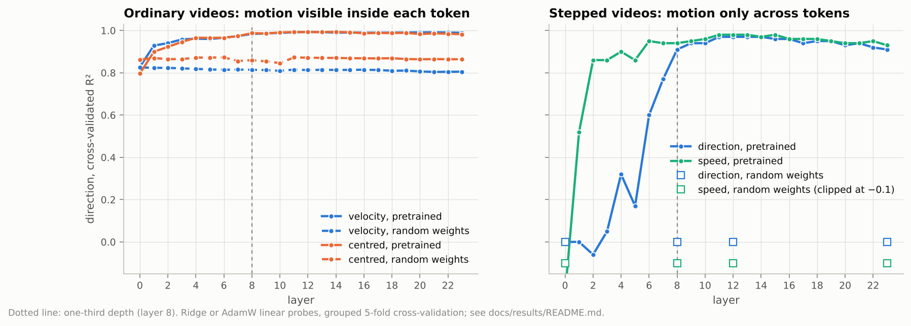
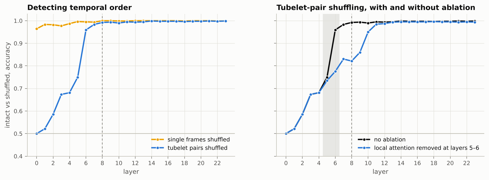
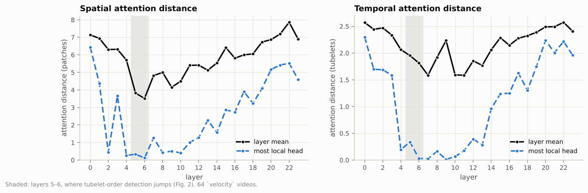
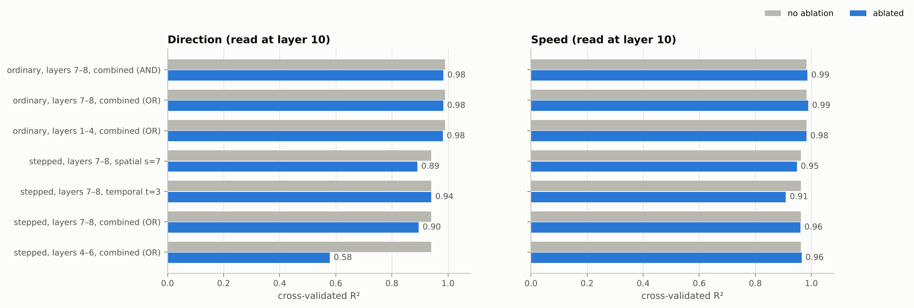
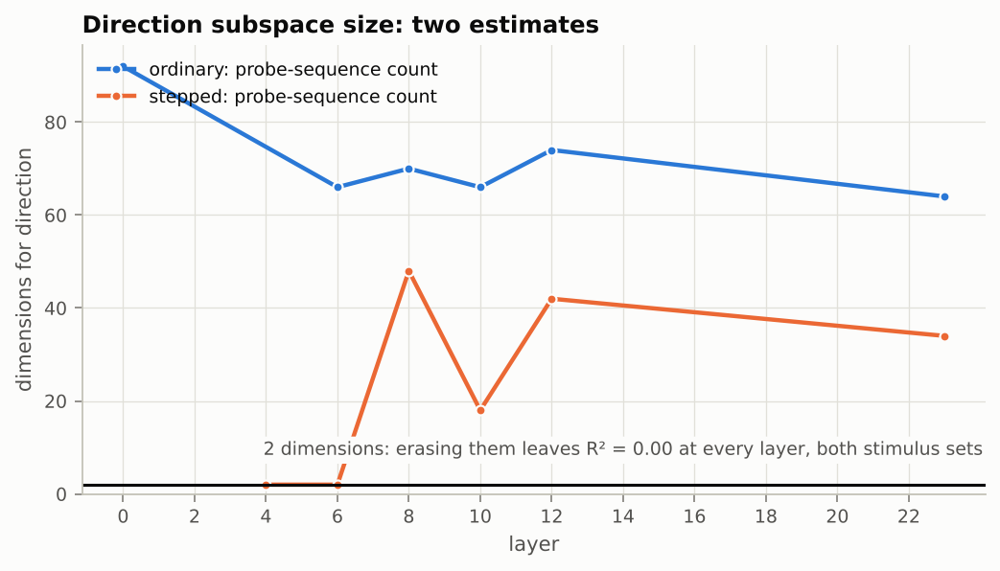
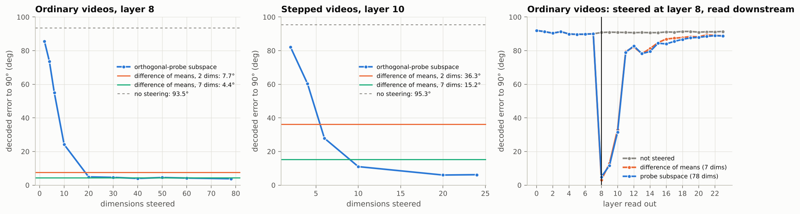
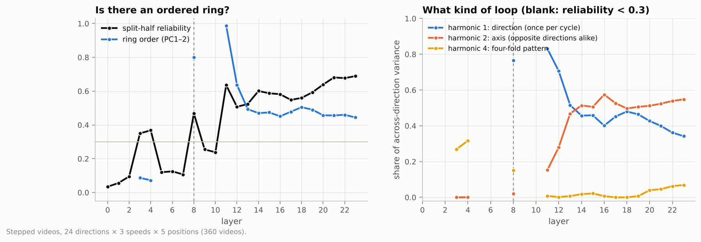

# Findings: physical variables in V-JEPA 2-L

An independent, partial replication of Joseph et al. (2026), *Interpreting Physics in Video World
Models* ([arXiv:2602.07050](https://arxiv.org/abs/2602.07050)), with additional control
experiments. The code and stimuli are this repository's own, not the original authors'.
Model: V-JEPA 2 ViT-L (`facebook/vjepa2-vitl-fpc64-256`), 16 frames at 224 × 224.
Numbers: [`docs/results/`](docs/results/README.md). Figures: `python docs/make_figures.py`.

**Status: preliminary.** Single runs on one model size, with this repository's own renderer and
code, not independently reviewed. Where results differ from the paper, the most likely
explanations are differences in setup (stimuli, preprocessing, unspecified settings) or errors
here, not errors in the paper.

## Summary

1. **On ordinary moving-ball videos, motion direction is linearly decodable from the first layer**
   (R² 0.83), and nearly as well from a randomly initialised network (R² 0.81–0.86). V-JEPA 2
   encodes each pair of frames as one token (tubelet size 2), so motion is visible inside single
   tokens. With these stimuli the paper's emergence of direction at about one-third depth
   is not observed; pretraining instead raises decoding from about 0.8 to 0.99. Why the
   paper's videos behave differently is not established here (see Limitations).
2. **When motion is removed from inside tokens** (the ball is static within each frame pair and
   moves between pairs), **a pattern like the paper's appears**: direction is at R² ≈ 0 at layers
   0–3 and reaches 0.91 at layer 8 (not monotonically: 0.32 at layer 4, 0.17 at layer 5), speed
   is decodable earlier (0.86 by layer 2), and a randomly initialised network decodes neither.
   Stepped videos never occur in natural footage, so this is a diagnostic, not natural motion.
3. **On stepped videos, removing local attention at layers 4–6 reduces direction decoding.**
   Direction R² at layer 10 falls from 0.94 to 0.58 while speed is unchanged (0.96 → 0.97); later
   layers recover part of it. The same ablation at the paper's layers (7–8) gives 0.89–0.94. On
   ordinary videos no ablation tested changes direction. The paper reports 0.97 → 0.14 for its
   combined condition; no condition here comes close to a drop of that size.
4. **Shuffle detection rises sharply between layers 5 and 6.** Telling intact videos from videos
   with shuffled frame pairs rises gradually from chance (0.50) at layer 0 to 0.75 at layer 5,
   then to 0.96 at layer 6. Removing local attention at layers 5–6 delays it (0.78 at
   layer 6, 0.82 at layer 8), with recovery by layer 10–11. The most local attention heads are at
   similar layers.
5. **Dimension counts depend on the method.** Removing the two directions most correlated with
   (sin θ, cos θ), estimated on training videos, leaves held-out R² = 0.00 at every layer tested,
   on both stimulus sets. This is close to guaranteed for any variable that is linearly decodable,
   so it shows that two directions suffice to *erase* the linear signal, not that the model stores
   direction in two dimensions. The paper's orthogonal-probe count gives 64–92 (ordinary) and
   2–48 (stepped) dimensions. In steering, a 2-dimensional difference-of-means shift steers poorly
   on stepped videos (36° error) while 10 orthogonal probes (20 dimensions) reach 6°.
6. **Steering inside the running network fades.** A steer added to every token at layer 8
   (ordinary videos) is read as the target by layer 8's probe (3–5° error) but no longer by
   layer 11's (79°). Why is not established: on ordinary videos the true motion is still present
   in every token, so later layers may recompute it, and a single shift added to all tokens is a
   crude edit.
7. **Shape of the direction code (stepped videos, 24 directions):** no reproducible structure at
   layers 0–2; an ordered ring by layer 11 (ring order 0.99); from layer 12 on, a growing second
   harmonic (opposite directions represented alike, up to 55% of the variance by layer 23). A
   weak four-fold pattern at layers 3–4 appears in one computation of the statistics but not in
   another (see Results 5), so it is not treated as a finding.

All results come from single runs (one seed, one cross-validation split per fold).

## Scope and comparison with the paper

| Claim in the paper | Result here | Status |
|---|---|---|
| Speed and acceleration magnitude are decodable from early layers | speed R² 0.98 (ordinary), 0.86 by layer 2 (stepped); acceleration 0.97 at layer 0 | reproduced |
| Direction emerges at about one-third depth | not on ordinary videos (0.83 at layer 0); yes on stepped videos (0.00 → 0.91 by layer 8) | not reproduced on ordinary videos; a similar pattern only without within-token motion |
| Shuffled-video detection shows a similar emergence | single-frame shuffling: 0.96 at layer 0; tubelet-pair shuffling: 0.50 → 0.96 at layer 6 | reproduced with tubelet-pair shuffling |
| Local heads appear at the transition | most local heads at layers 4–10; minimum mean spatial distance at layers 5–6 | reproduced |
| Direction-tuned MLP units tile 360°, absent in early layers and emerging at the transition | 360° coverage at every layer, including layer 0; tuning strength rises at layers 4–5 (ordinary videos) | partly: tiling present, but not absent early (consistent with direction being available at layer 0 on these videos) |
| Combined local-attention ablation removes direction (0.97 → 0.14) | largest drop 0.94 → 0.58, at layers 4–6 on stepped videos; no effect on ordinary videos | partly: an effect on stepped videos, much smaller, earlier |
| Direction needs many orthogonal probe dimensions | 18–92 by that method; erasing 2 directions removes linear decodability | method-dependent |
| One probe cannot steer direction; ~20 can (82.9° → 11.9°) | 1 probe: 82–86°; 10–20 probes: 4–6° | reproduced |
| Direction and violation-of-expectation subspaces are near-orthogonal (69–75°) | 63–75° across the layers tested, against 73–76° for random subspaces of the same sizes; uses this repository's `permanence` set, not IntPhys | not distinguishable from random subspaces here; different dataset |
| Violation-of-expectation accuracy peaks mid-network and declines toward the output | `permanence` set: rises to 0.98–1.00 at layers 18–23, no decline | not tested (IntPhys not run; the stand-in is likely easier) |

Not tested: IntPhys itself, V-JEPA 2-H and -g, VideoMAE-v2, the CLEVRER / ImageNet /
Something-Something-v2 controls, and the predictor-based analyses.

## Methods in brief

- **Stimuli** (`physprobe/stimuli.py`): top-down orthographic renders of a ball of radius 0.3 m
  on an 8 × 8 m textured floor, 16 frames at 24 fps, flat shading with a contact shadow. The
  paper renders with Kubric/Blender and a perspective camera; trajectories match its
  description, pixels do not.
  - `velocity`: 8 directions × 7 speeds (1–7 m/s) × 7 start positions = 392 videos.
  - `velocity_centered`: as above, but each trajectory passes through its position at mid-clip.
  - `velocity_stepped`: as `velocity_centered`, with the ball static for the two frames of each
    tubelet and moving between tubelets. Also run with 24 directions × 3 speeds × 5 positions.
  - `shuffled_pairs`: each `velocity` video intact and with its 8 tubelets in random order.
  - `permanence`: a ball passes behind a panel and continues, vanishes, jumps sideways or grows
    (matched pairs; 240 videos). A stand-in for IntPhys.
- **Activations**: residual stream after each of the 24 blocks, mean-pooled over 1568 tokens.
- **Probes**: linear, grouped 5-fold cross-validation (groups: start position or matched scene);
  directions regressed as (sin θ, cos θ). Ridge (penalty chosen on a grouped validation split) or
  the paper's 20-configuration AdamW sweep; the table README lists which run used which.
- **Ablations**: attention logits from each query to keys within the given spatial (patches) or
  temporal (tubelets) distance are masked before the softmax at the stated layers, all heads.
  "Combined s = 3, t = 1" removes keys within 3 patches *or* within 1 tubelet; under *and* it
  would remove a subset of what "spatial s = 7" removes, inconsistent with the paper's finding that
  combined is the most damaging. Runs with *and* are reported for comparison.
- **Subspaces and steering**: orthogonal probe sequences and stop thresholds as in the paper;
  erasure removes the rank-*k* cross-covariance between activations and target (k = 2 for an
  angle). Steering follows the paper's 70/30 protocol with an evaluation probe that never sees
  the activations it scores ("strict"). The difference-of-means control shifts each activation by
  (target-condition mean − own-condition mean), restricted to the top 2 or all 7 principal axes of
  the condition means.
- **Shapes**: condition means per value; split-half reliability across start positions;
  noise-corrected harmonic content and dimensionality; statistics omitted where reliability < 0.3.

## Results

### 1. The tubelet shortcut



| Direction R² | layer 0 | layer 4 | layer 8 | layer 12 | layer 23 |
|---|---|---|---|---|---|
| `velocity`, pretrained | 0.83 | 0.96 | 0.98 | 0.99 | 0.99 |
| `velocity`, random weights | 0.83 | 0.82 | 0.81 | 0.81 | 0.81 |
| `velocity_centered`, pretrained | 0.80 | 0.97 | 0.99 | 0.99 | 0.98 |
| `velocity_centered`, random weights | 0.86 | 0.87 | 0.86 | 0.87 | 0.86 |
| `velocity_stepped`, pretrained | 0.00 | 0.32 | 0.91 | 0.97 | 0.91 |
| `velocity_stepped`, random weights | 0.00 | – | 0.00 | 0.00 | 0.00 |

Centring the trajectories changes nothing, so the early signal is not the ball's mean position.
It is present without training, so it is available in the input itself. It disappears when
nothing moves inside a tubelet. On stepped videos, speed reaches 0.52 at layer 1 and 0.86 at
layer 2, well before direction (0.32 at layer 4, 0.17 at layer 5, 0.60 at layer 6, 0.91 at
layer 8); the ordering of the two variables matches the paper.

### 2. Temporal order and local attention



| Intact vs tubelet-pair shuffled (accuracy) | 5 | 6 | 7 | 8 | 9 | 10 | 11 |
|---|---|---|---|---|---|---|---|
| no ablation | 0.75 | 0.96 | 0.98 | 0.99 | 0.99 | 0.99 | 0.99 |
| local attention removed at layers 5–6 | 0.74 | 0.78 | 0.83 | 0.82 | 0.86 | 0.95 | 0.99 |



The layer-mean spatial attention distance is lowest at layers 5 and 6 (3.8 and 3.5 patches).
Heads attending almost entirely within their own patch and tubelet appear from layer 4
(most local head: 0.27 patches, 0.20 tubelets) and persist to about layer 10.

### 3. Attention ablations



| Read at layer 10 | direction R² | speed R² |
|---|---|---|
| `velocity`, no ablation | 0.99 | 0.98 |
| `velocity`, layers 7–8, combined (and / or) | 0.98 / 0.98 | 0.99 / 0.99 |
| `velocity`, layers 1–4, combined (or) | 0.98 | 0.98 |
| `velocity_stepped`, no ablation | 0.94 | 0.96 |
| `velocity_stepped`, layers 7–8: spatial s=7 / temporal t=3 / combined | 0.89 / 0.94 / 0.90 | 0.95 / 0.91 / 0.96 |
| `velocity_stepped`, layers 4–6, combined | **0.58** | 0.97 |

On ordinary videos no ablation affects direction, consistent with direction being available
within tokens. On stepped videos, the layer 4–6 ablation also lowers direction at layers 12
(0.97 → 0.87) and 23 (0.91 → 0.77), so later layers recover only part of it.

### 4. Dimensions and steering



| Direction | layer 4 | 6 | 8 | 10 | 12 | 23 |
|---|---|---|---|---|---|---|
| `velocity`: orthogonal-probe dimensions | – | 66 | 70 | 66 | 74 | 64 |
| `velocity_stepped`: orthogonal-probe dimensions | 2 | 2 | 48 | 18 | 42 | 34 |
| R² after erasing 2 dimensions (both sets) | 0.00 | 0.00 | 0.00 | 0.00 | 0.00 | 0.00 |

(`velocity` layer 0: 92 dimensions. At `velocity_stepped` layers 4–6 the first probe already scores
below threshold, R² 0.18 and 0.65, so the sequence stops.) In tests on synthetic data with a
direction signal planted in exactly two dimensions and anisotropic noise, the orthogonal-probe
procedure reported 4–14 dimensions; it removes probe weight directions, which differ from the
signal directions when the noise is anisotropic.



| Decoded error to 90° | none | 1 probe | 5 probes | 10 probes | mean shift, 2 dims | mean shift, 7 dims |
|---|---|---|---|---|---|---|
| `velocity`, layer 8 | 93.5° | 85.5° | 24.2° | 4.9° | 7.7° | 4.4° |
| `velocity_stepped`, layer 10 | 95.3° | 82.1° | 11.0° | 6.0° | 36.3° | 15.2° |

On stepped videos the direction main effect accounts for 3–18% of the total activation variance
(9–45% on ordinary videos) and the condition means are less reliable (split-half 0.40 at layer
10), which plausibly makes mean-based shifts noisier than trained probes. Injecting the layer-8 shift into
every token of the running network (ordinary videos, 64 held-out videos) gives a decoded error
of 3–5° at layer 8, 12° at layer 9, 32° at layer 10 and 79° at layer 11, close to the unsteered
91° thereafter. Each later layer is read by a probe trained on unsteered activations at that
layer, so this shows that those probes stop reading the target, not why: the true motion is
still visible in every token of these videos, and the edit may also persist in a form the probes
do not read. Repeating this on stepped videos, with per-token edits, would separate these.

### 5. Shape of the direction code



| Stepped, 24 directions | reliability | harmonic 1 | harmonic 2 | harmonic 4 | ring order |
|---|---|---|---|---|---|
| layers 0–2 | ≤ 0.10 | – | – | – | – |
| layer 3–4 | 0.35–0.37* | 0.00 | 0.00 | 0.27–0.32 | 0.07–0.09 |
| layer 8 | 0.47 | 0.77 | 0.02 | 0.15 | 0.80 |
| layer 11 | 0.64 | 0.83 | 0.15 | 0.01 | 0.99 |
| layer 16 | 0.58 | 0.40 | 0.58 | 0.01 | 0.45 |
| layer 23 | 0.69 | 0.34 | 0.55 | 0.07 | 0.44 |

\* The precomputed shapes in the explorer's results bundle
(`results/vjepa2-l/stepped24/acts/shapes/direction_deg.csv`) give reliability 0.19–0.21 at
layers 3–4, below the 0.3 threshold, and so no shape statistics there. The cause of the
difference has not been checked (the two computations may split the videos into halves
differently); either way, the layer 3–4 structure is not robust. From layer 8 on both agree closely (for example ring order 0.80 / 0.80 at layer 8 and
0.99 / 0.99 at layer 11; reliability 0.47 / 0.39 and 0.64 / 0.59).

Harmonics 1 and 2 together carry about 90% of the direction-related variance from layer 12 on: a
closed curve in four dimensions that winds once (direction) and twice (axis of motion).
Decoding remains high (R² 0.91–0.97), so direction is still recoverable while the dominant
geometry is axis-like. Reliability dips at layers 5–7 and 9–10 on both the 8- and the
24-direction stepped sets; this is not explained here. With 8 directions, harmonic 4 also absorbs
higher harmonics (aliasing), which overstated it at layers 8–10.

On ordinary videos the direction ring is already ordered at layer 4 (ring order 0.95) but
flattened (circularity 0.37), becomes round at layers 8–16 (circularity 0.87–0.94) and develops a
second harmonic toward the output (0.45 at layer 23).

## Limitations and open questions

- **Stepped videos are out of distribution.** Natural video never freezes for two frames, so the
  late emergence on stepped videos may partly reflect unfamiliar motion rather than the model's
  normal computation. A natural manipulation (slow speeds or motion blur, which shrink
  within-token displacement without making motion jerky) has not been run.
- **The main disagreement is unexplained.** Any continuously moving ball, including the paper's,
  moves within each two-frame tubelet, so within-token motion is presumably present in the
  paper's videos too. Why it does not make direction decodable early there is not known.
  Candidate differences: rendering (the paper uses Kubric/Blender with a perspective camera 10 m
  above the floor, rendered at 256 × 256; here a flat-shaded orthographic renderer), the ball's
  size and displacement in pixels, preprocessing, probe details, or an error in this repository.
  Running IntPhys and rendering a few scenes with Kubric would narrow this down.
- **Single runs.** No repeated seeds or resampled splits. Fold standard deviations are in the
  copied tables (typically 0.003–0.06).
- **Some numbers are transcribed by hand** from printed command output rather than copied from
  result files (listed in [`docs/results/README.md`](docs/results/README.md)), and the probe
  solver for the random-weights runs is not recorded in the result files.
- **Not independently checked.** The code was written for this project with heavy use of an AI
  coding assistant. The self-test checks the analyses on planted structure, but the pipeline has
  not been reviewed by anyone else.
- **Settings not specified in the paper**, chosen here: resolution 224 (the checkpoint was
  trained at 256), frame sampling, cross-validation groups, probe epochs, the meaning of
  "combined", which layers are read out after ablation, and which heads are ablated (all).
- **Violation of expectation** was measured on a stand-in dataset, not IntPhys.
- One model size.

## Reproducing

```bash
pip install -e ".[gui]"
python -m physprobe selftest                  # 60 checks on planted structure, no weights needed
bash scripts/run_replication.sh               # paper protocol, including propagated steering
bash scripts/run_controls.sh                  # centred / stepped / shuffled-pair controls and ablations
python -m physprobe gui                       # explore the results
```
